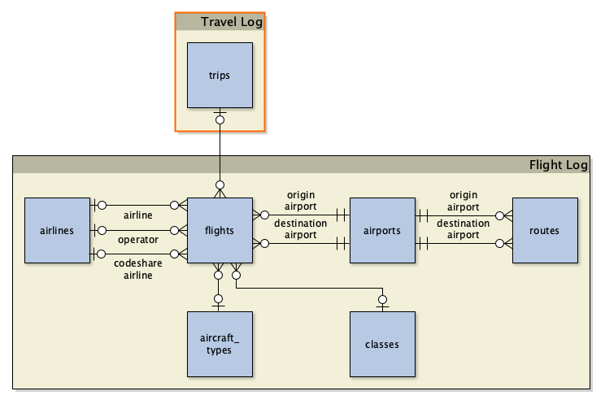

# Travel Log Data Schema

The travel log data uses a [GeoPackage file](https://www.geopackage.org/) containing travel log data for a single traveler. (Travel log data is data that doesn't fall under a specific travel mode.)

> [!NOTE]
> An empty, ready-to-use travel log GeoPackage file is available at [travel_log.gpkg](/src/pbtravellog/data/templates/travel_log.gpkg).

## GeoPackage Layers

> [!NOTE]
> Columns use the data types specified in the GeoPackage Encoding Standards [Table 1. GeoPackage Data Types](https://www.geopackage.org/spec/#table_column_data_types), and geometry types specified in [Annex G: Geometry Types (Normative)](https://www.geopackage.org/spec/#geometry_types). Optional fields must be null when unused. All layers should use `geom` as the geometry column with a CRS of EPSG:4326 (WGS 84).



### trips (No Geometry)

The `trips` table contains records for trips that flights belong to.

| Column | Data Type | Description |
|--------|-----------|-------------|
| `fid`  | INT (64 bit) | Primary key for the trip record. |
| `name` | TEXT | Name of the trip. |
| `start_date` | DATE | Start date of the trip in the local time zone of the departure location.
| `end_date` | DATE | End date of the trip in the local time zone of the trip completion location.
| `comments` | TEXT | *Optional.* Comments about the trip. |


## OGR Schema

The above schema is defined in [ogr_schema_travel_log.json](/src/pbtravellog/data/schema/ogr_schema_travel_log.json). If you wish to generate the GeoPackage file yourself (rather than using the pre-made [template](/src/pbtravellog/data/templates/travel_log.gpkg)), download the schema JSON and run:

```bash
gdal vector create --schema ogr_schema_travel_log.json travel_log.gpkg
```
